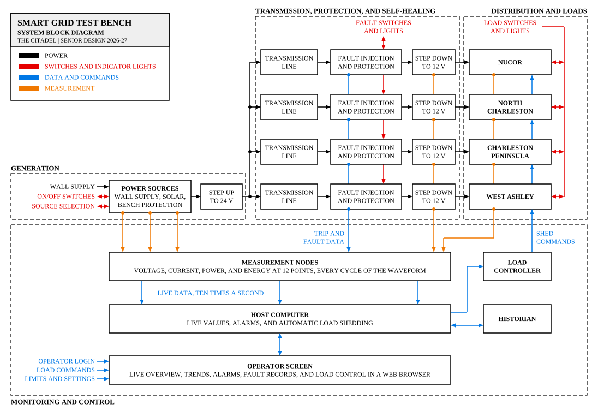

# Smart Grid Test Bench (SGTB)

A low-voltage benchtop power grid with dual-source generation, islanded fault protection
and self-healing restoration (FLISR), automatic load shedding, and an end-to-end, custom-designed
SCADA stack.

**The Citadel, Department of Electrical and Computer Engineering.**
Senior design project, academic year 2026-27.

## Overview

The bench is a low-voltage model of an electric grid, built for teaching and
demonstration. A wall source and a solar source feed four transmission
branches, each with a switchyard that detects a fault, isolates it, and
restores service from a neighboring branch. Four load modules represent six
Charleston-area customers and are shed in a fixed order when demand exceeds
supply. A supervisory system meters the bench, records its history, and gives
an operator control through a browser.

The bench is built as four modules.

| Module | Title |
| --- | --- |
| M1 | Generation and Conversion |
| M2 | Transmission; Faults, Protection, and Restoration |
| M3 | Distribution and Load |
| M4 | Supervisory Control and Data Acquisition (SCADA) |

Black lines are power, red lines are operator switches and indicator lights,
blue lines are data and commands, and orange lines are measurements.

## Repository layout

Each module keeps its work in one folder at the root.

| Path | Content |
| --- | --- |
| `Module4/` | Module 4 firmware and host software. `Module4/README.md` describes every folder, and `Module4/DIRECTORY.md` lists every file. |
| `Module4/regmap/` | `regmap.yaml`, the single source of every register address. No address is edited by hand anywhere else. |
| `Module4/tools/` | `gen_regmap.py`, which validates the register map and generates the files below. |
| `Module4/generated/` | C headers, the tag table for the host, and the register tables for the interface documents. Generated; not edited. |
| `Module4/firmware/` | Portable C libraries (Modbus RTU slave, register banks, measurement math, fault record, controller link) and the board firmware for the NUCLEO-G474RE. |
| `Module4/host/` | Host service in Python: fieldbus poller, alarms, demand controller, SQLite historian, and supervisory API. |
| `Module4/sim/` | Simulated nodes and load control unit on virtual serial ports. |
| `Module4/tests/` | Unit tests, end-to-end tests, and an emulated run of the board firmware. |
| `docs/` | Figures used by this file. |

Folders for Modules 1 to 3 are added by their owners.

## Module 4 software

The portable code builds and tests on a PC; no bench hardware is needed. The
commands below are run from `Module4/`.

| Command | Result |
| --- | --- |
| `make test` | Regenerates and checks the register map, then runs the unit tests, the cross-check, and the end-to-end tests. |
| `make sim` | Runs the simulated nodes and load control unit. |
| `make host` | Runs the poller, historian, and API against the simulator or the bench. The API is documented at `http://127.0.0.1:8000/docs`. |
| `make fw` | Builds the five node images for the NUCLEO-G474RE. |
| `make emu` | Runs the node images on a Cortex-M4 emulator. |
| `python3 tools/gen_regmap.py` | Regenerates `generated/` after any edit to `regmap/regmap.yaml`. |

Requirements:

- Linux, `make`, and a C99 compiler.
- Python 3 with the packages of `Module4/requirements.txt`.
- `arm-none-eabi-gcc` for `make fw` only.

### Design in brief

- **Measurement.** Five nodes sample voltage and current at 3840 Hz and
  compute RMS voltage and current, active, reactive, and apparent power, power
  factor, frequency, and energy for each cycle.
- **Fieldbus.** The host polls every node at 10 Hz over Modbus RTU on RS-485.
  Measured values are float32 in engineering units.
- **Fault record.** At a protection trip, a node holds the per-cycle results
  from 0.2 s before to 2.0 s after the trip, with a clip of raw samples.
- **Load control.** The host commands eight shed contacts through a load
  control unit on a second RS-485 segment, and sheds and restores load
  automatically against a demand limit.
- **Historian.** One SQLite database holds 1 Hz samples for 24 hours and
  one-minute trends, state changes, commands, alarms, and the audit trail for
  60 days.
- **Supervisory API.** The HMI reads live values and sends commands through
  one API with sessions, three roles, and an audit entry for every change.

## Interface documents

The modules meet at six interface control documents. The documents, not the
code, are the reference for every interface.

| Document | Title |
| --- | --- |
| ICD-1 | Node Electrical and Mechanical Interface |
| ICD-2 | Data Point Dictionary and Supervisory Register Map |
| ICD-3 | Supervisory API and Data Model |
| ICD-4 | Status and Data Link, Switchyard Controller to Measurement Node |
| ICD-5 | Historian Schema and Export |
| ICD-6 | Load Control Register Map, Host to the Load Control Unit |

## Status

As of November 22, 2026:

- The design phase is complete, and the Design Report was issued on
  November 3, 2026.
- The Module 4 portable code passes 420 checks in seven test suites and 131
  register readbacks on a PC.
- The Module 4 board firmware compiles and passes 109 checks on an emulated
  board. It has not yet run on hardware.
- Proof-of-concept testing of each module follows in the fall semester, and
  integration of the bench in the spring semester (ELEC 422).

## Conventions

- **Source comments.** Every source file opens with the header defined in
  `Module4/README.md`. Functions are described in one directive, and
  variables are named with their units.
- **SCADA level.** Each file header states the level of the file in the
  ISA112 SCADA model architecture, so that the place of each file in the
  system is known.
- **Register addresses.** An address is written with its register type, as in
  IR 80 (input register) and HR 150 (holding register), zero-based.
- **Branches.** Work is done on a branch per module and merged into `main`
  through a pull request.

## Contact

Thomas Bassett, Project Manager and Module 4

Go Dogs
